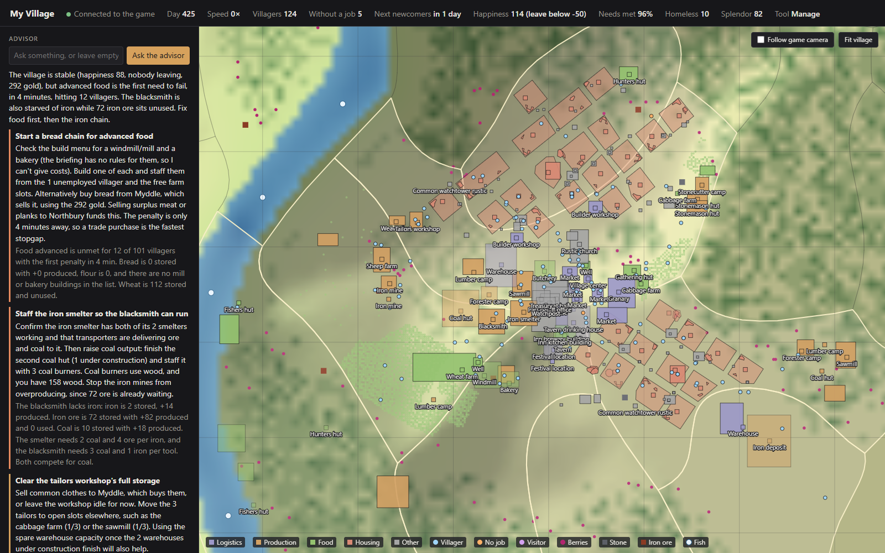

# Foundation advisor

A live dashboard and an LLM advisor for [Foundation](https://www.polymorph.games/foundation/), the medieval city-builder by Polymorph Games. It reads the state of a running game, shows it on a local web page with a map, and can ask Claude what to do next.



This is an unofficial fan project. It is not made, endorsed or supported by Polymorph Games.

## What it shows

- **Village:** day, speed, population, happiness and the level below which villagers leave, share of needs met, homeless count, splendor.
- **Problems:** the game's own warnings, building statuses such as "storage full" or "lacks coal", and which needs are unmet for how many villagers.
- **Economy:** stock per resource and where it is held, what was produced, used and traded this week, income and expenses by category, taxes in force.
- **People and places:** jobs, what villagers are doing, houses and their residents, trade routes and what each village buys and sells, estates, unlocks.
- **Map:** terrain height, water, forest, natural deposits with what is left in them, region borders with your land highlighted, building outlines, house lots, villagers and visitors. It can follow the game camera.
- **Advisor:** on a click, a condensed briefing of the village plus the rules of the buildings involved goes to Claude, which answers with a short list of prioritised, concrete tips. You can also ask a question.

## Before you use it

Read this first; the tool is intrusive by design.

- **It changes the running game in memory.** To read state the game hides from mods (needs, happiness, the budget), a script replaces two instructions in the game process at start. Nothing on disk is modified, and it refuses to act on any game version other than the one it was written for. It can still crash the game.
- **It needs a mod in the save.** A small companion mod adds a hidden daily event, a placeholder tax that collects nothing, and one invisible object to the village. A save made with it expects the mod to be present.
- **Use a new village, or back up your save.** It has only been used on games started with the mod selected.
- **Tested on one setup only:** Foundation 1.12.0.14 from Steam, on Windows 11. Whether it affects achievements is not known.
- **The advisor costs money.** Each click is one request to the Claude API on your own key. Nothing calls it automatically.

## Requirements

- Windows, with Foundation installed through Steam
- [Node.js](https://nodejs.org/) 24 or newer and [pnpm](https://pnpm.io/)
- For the advisor only: an [Anthropic API key](https://console.anthropic.com/)

## Setup

```
pnpm install
pnpm install-bridge
pnpm server
```

`install-bridge` copies two things into `Documents\Polymorph Games\Foundation`: the bridge script into `moddev`, and the companion mod into `mods\Companion Bridge`. `pnpm install-bridge --remove` deletes both.

If the game is not in `C:\Program Files (x86)\Steam\steamapps\common\Foundation`, change `GAME_DIR` in `server/src/config.ts` and at the top of `bridge/bridge.lua` first.

Then:

1. Start Foundation.
2. Start a **new game** and select the **Companion Bridge** mod during setup.
3. Open http://127.0.0.1:47801/. The page fills in within about 20 seconds of the village loading, once the first in-game day has passed.

### The advisor

Put your key in a file named `.env` in the project folder, then restart the server:

```
ANTHROPIC_API_KEY=sk-ant-...
```

If the API answers that the key is not scoped to a workspace, add `ANTHROPIC_WORKSPACE_ID=wrkspc_...` as a second line.

The advisor gives better answers when it knows the game's rules. With a village loaded, run this once; it reads costs and recipes out of the running game into `docs/rules-summary.json` (the game stutters for about two minutes):

```
pnpm dump-rules
pnpm summarize-rules
```

The model is `claude-sonnet-5-5` unless `ADVISOR_MODEL` says otherwise. To see exactly what the advisor is told, open http://127.0.0.1:47801/briefing; that page needs no key.

## How it works

```
foundation.exe                      Node (TypeScript)                 Browser
┌───────────────────────┐   TCP   ┌────────────────────┐   events   ┌─────────────┐
│ bridge.lua            │ ──────► │ server             │ ─────────► │ dashboard   │
│  state snapshots      │  JSON   │  event detection   │            │  panels     │
│  terrain survey       │ ◄────── │  briefing, advisor │ ◄───────── │  map        │
│  runs Lua sent to it  │         └────────────────────┘   click    └─────────────┘
└───────────────────────┘                    │
                                             ▼ Claude API (only on a click)
```

- **Getting in.** The game runs any Lua file in its `moddev` folder without the mod sandbox; the folder exists so that a debugger can attach, and the game ships LuaSocket for it. The bridge lives there.
- **Getting called.** The unmodded game runs no Lua during play. The companion mod hands the bridge a mod object, through which it registers a component the game updates every frame.
- **Reading state.** Every two seconds the bridge walks the game's objects through the Lua interface and sends a snapshot. Terrain is measured once with ray casts on a 256 x 256 grid.
- **Reading hidden state.** The engine marks each C++ property with flags and only lets Lua read some. The bridge lifts that check in memory, which makes about 4,500 further properties readable through the same interface. Writing them stays blocked.
- **Advice.** The server condenses a snapshot into about a page of facts, adds the rules for the buildings involved, and asks Claude for structured tips.

The full account, including what was tried and did not work, is in [docs/knowledge.md](docs/knowledge.md).

## Commands

| Command | Does |
|---|---|
| `pnpm server` | Runs the bridge server and the dashboard. Reads `.env` if present. |
| `pnpm install-bridge` | Installs or updates the bridge and the mod. `--remove` uninstalls them. |
| `pnpm eval "<lua>"` | Runs Lua inside the game and prints what it returns. `-f file.lua` runs a file. |
| `pnpm inspect "<lua>"` | Prints everything a live game value answers to, a few levels deep. |
| `pnpm probe-api --properties` | Asks live game objects which names they answer to; writes `docs/api/*.json`. |
| `pnpm dump-rules` | Dumps the game's rules (buildings, costs, recipes, resources, jobs, needs) into `docs/rules/`. |
| `pnpm summarize-rules` | Condenses that dump into `docs/rules-summary.json` for the advisor. |
| `pnpm screenshot` | Takes a screenshot of the dashboard with headless Edge. |
| `pnpm test` | Runs the tests, including the bridge in a Lua VM against the server. |
| `pnpm typecheck` | Type-checks the TypeScript. |

After changing `bridge/bridge.lua`, run `pnpm install-bridge` and then `pnpm eval "__bridge.reload()"`. The eval reports "game disconnected"; that is the old copy closing its connection, and the new one reconnects within a few seconds. No game restart is needed.

## Layout

```
bridge/bridge.lua   runs unsandboxed inside the game: snapshots, terrain survey, remote Lua
bridge/mod/         companion mod that gets the bridge called every frame
server/             TypeScript: connection to the game, events, briefing, advisor, HTTP
web/index.html      the dashboard
tools/              screenshot script; re/ holds the Python scripts used to analyse the binary
docs/knowledge.md   what was learned about the game, and how
docs/api/           the members each game class answers to, probed live
docs/reflection/    every reflected C++ property with its flags, read from the binary
```

## Rules for running Lua in the game

Learned the hard way; details are in [docs/knowledge.md](docs/knowledge.md).

- Never call `tostring` on a game object, and never pass one to `mod:log`. For some objects the game's formatter reads through a null pointer and the game crashes; `pcall` cannot catch that.
- Never index a mod object with a name it might not have; the game then rejects the mod.
- Indexing any other game object with an unknown name is safe and returns nil.

## Limitations

- Only new games started with the mod. The game has an "Edit Save Game Mods" option that may allow adding it to an existing save; that has not been tried.
- A villager's status (serf, commoner, ...) and the zones painted on the map are not read yet.
- The advisor only advises. It does not act in the game.
- A game update will most likely disable the hidden-state reading until the two addresses are found again; the rest should keep working.
